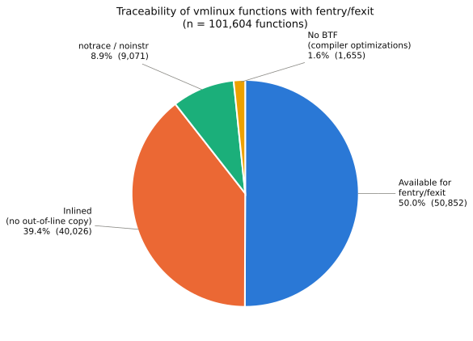

# Adding inlined functions to the BPF Type Format

## Introduction

One of the common pain points for kernel tracing is when we attempt
to attach tracing to a function and attachment fails.  This failure
can happen for a number of reasons, and once we have understood these
we will be in a better position to see the value of having inline
function information.

## The problem of missing functions

Here we discuss some of the reasons you may not be able to trace
a function.

### 1. "notrace"/"noinstr" functions

#### Problem

The function itself is marked "notrace" or "noinstr" ; this is the case
for functions that are themselves invoked as part of the tracing
infrastructure.  As you can imagine, tracing a function which
then fires again because you are tracing, leading to a further
firing and so on is a big problem.

#### Diagnosis

A function is in `/proc/kallsyms` but not in `/sys/kernel/tracing/available_filter_functions`.

#### Solution

Instead of relying on `/proc/kallsyms` to find traceable functions,
use `/sys/kernel/tracing/available_filter_functions`, or even
better `/sys/kernel/tracing/available_filter_functions_addrs` which
has both function address, name and optional module:

```
$ sudo cat cat /sys/kernel/tracing/available_filter_functions_addrs
ffffffff84000014 trace_initcall_level_cb
ffffffff84000044 trace_initcall_start_cb
ffffffff84000100 run_init_process
ffffffff84000210 try_to_run_init_process
```

It is not possible to trace these notrace functions, but at least
we can see which ones they are.

### 2. Optimized functions with changed function signatures

#### Problem

To attach BPF tracing using fentry/fexit, it is vital that the BPF
Type Format (BTF) information contains the function signature
as a `BTF_KIND_FUNC/FUNC_PROTO`; without this the verifier cannot
safely attach to the function.  For optimized functions which omit
parameters or have their parameters in unexpected locations rather
than the expected registers from the ABI, BTF is often omitted.

#### Diagnosis

Determine if the function made it into BTF:
```
$ bpftool btf dump file /sys/kernel/btf/vmlinux |grep myfunc
...
```

If the kernel was built with gcc, optimized functions will have
a `.isra` or `.constprop` suffix, for example `crypt_iv_tcw_whitening.isra.0`.

#### Solution

Instead of fentry/fexit, use kprobe tracing instead, and be aware
that the parameters may not be in the registers you expect.

### 3. Inlined functions

#### Problem

Compilers make all sorts of choices to optimize the objects they
generate.  One big win is inlining, where a function - potentially
called in many different places - has its body placed into the
body of the caller(s).  This saves on function call overhead and
inlining is extensive in modern environments.

To give a sense of this, consider the numbers for just the kernel
vmlinux image itself.

On a representative distro kernel, I see around 50,000 un-inlined and
available to trace functions, while there are about 40,000 functions
that were inlined to about 400,000 sites.

That is we see nearly 10x inline sites vs available-to-trace functions.

You can see this by examining the kernel source; the "inline" hint
is used extensively (especially in headers containing small functions)
and `__always_inline` - which tries to ensure the function is inlined
rather than hinting to the compiler to do so - is used frequently too.

#### Diagnosis

The function is not in `/proc/kallsyms`.

#### Solution

None, aside from changing the code to avoid inlining.  Tricks include
making a function non-static, though even this breaks with a Link-Time
Optimized (LTO) kernel.

## Summing up

Below we categorize the set of functions on a Fedora 43-based kernel.



| Category | Functions | % |
|---|---:|---:|
| Available for fentry/fexit | 50,852 | 50.0% |
| Inlined (no out-of-line copy) | 40,026 | 39.4% |
| notrace / noinstr | 9,071 | 8.9% |
| No BTF (compiler optimizations) | 1,655 | 1.6% |
| **Total** | **101,604** | **100%** |

## Some good news

In fact it is possible to trace at an inline site using a kprobe.
kprobes can trace at most instructions (unlike fentry/fexit), but the
problem is that the only place we have information about inlining is
in the DWARF debuginfo which is hundreds of megabytes and often not
available on a system like BTF is.  BTF is found in /sys/kernel/btf
and is baked into the kernel image rather than being a separate
installable package like DWARF debuginfo.

So if we had a way to compactly represent the 400,000 inline sites
we could trace them.  However with 400,000 of anything the representation
needs to be as compact as possible - how to proceed?

## Steps towards a solution

So our aim is to add BTF kinds to the BPF Type Format to support inlining.
The representation chosen will need to be as compact as possible given
the number of inline sites, but at a minimum we want to connect

- the address of an inline site;
- the function that was inlined;
- the parameters to the inlined function, if available

A key part of what makes BTF compact is de-duplication; where duplicate
information is removed as part of BTF encoding.  De-duplication of
identical structures for example means we wind up with a single
`struct sk_buff` rather than a copy in each object file that makes
up the kernel and uses `sk_buff`s.

So to minimize the representation of inlines we want to ensure that
the representation is designed to take advantage of de-duplication.

But before getting to that, a few additional changes were needed
in and around BTF.

### Describing the describer - BTF kind layout information

We have seen that BTF is used to describe the set of types and
functions associated with an object.  And as part of the inline
work we want to introduce new BTF kinds to cover inline sites
and how to locate their parameters.

One problem we wanted to tackle is that it is painful every time
a new `BTF_KIND_*` is introduced as all the tooling needs to learn
about it.  An unfortunate fact is that in order to parse BTF, it
was necessary to know how all the kinds in that BTF were laid out.
So if a new kind was introduced, older tools that did not know about
it just gave up.

As a pre-requisite, [this series](https://lore.kernel.org/bpf/20260326145444.2076244-1-alan.maguire@oracle.com/) fixed this; it allows BPF tooling
to read a "kind layout" section in BTF which informs users about all
the kinds that can potentially be in that BTF.  This means that BTF
can still be parsed by older tools (as long as they support the
kind layout reading!), even if they do not know about new kinds.

## Inline support in libbpf, pahole and the kernel

## Using inline information to trace inlined functions

## Wrapping up


